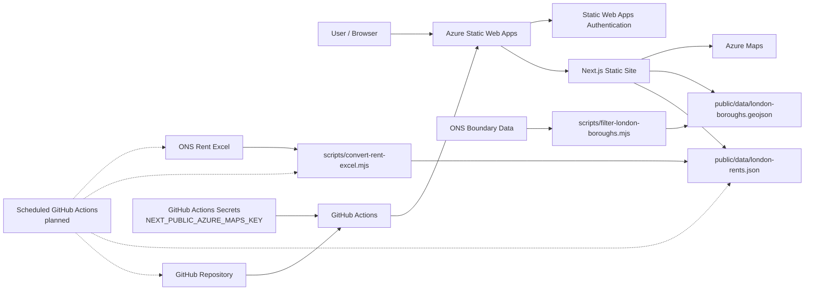
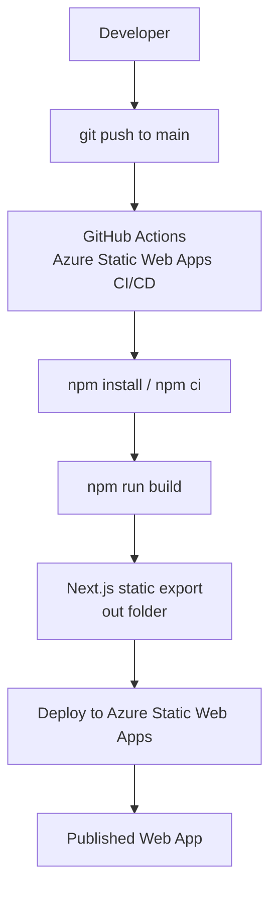
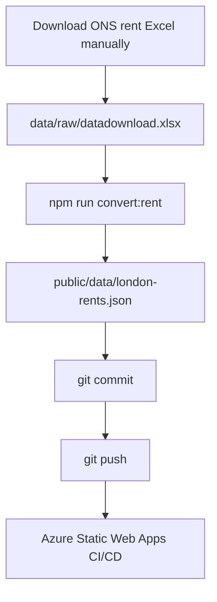
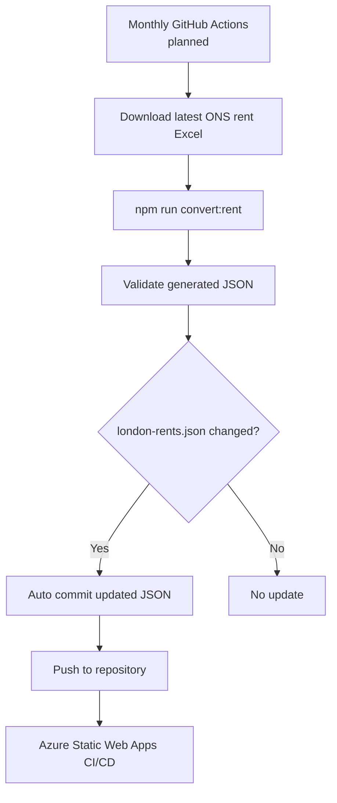

# London Life App

London Life App は、ロンドンで生活を始める人向けに、Webアプリです。
現在のMVPでは、ONSの家賃データとLondon borough境界データを利用し、ロンドン各エリアの家賃水準を地図上で確認できる機能を提供することで、
住居エリア選びを支援する機能を備えています。

## 現在のMVP範囲

現在実装済みの機能は以下です。

- Azure Static Web Appsへのデプロイ
- Azure Static Web Apps built-in authenticationによるログイン必須化
- Azure Mapsを利用したロンドン地図表示
- ONSのLondon borough境界データ表示
- ONSの家賃データをJSON化して利用
- 年月選択による家賃レンジの色分け
- boroughクリック時の家賃推移グラフ表示
- Rent Map / Recommended Restaurants のタブ構成
- ダークテーマベースのUI
- レスポンシブ対応

Recommended Restaurants タブは将来機能のプレースホルダーとして表示しています。

## 技術スタック


| 項目             | 内容                                            |
| -------------- | --------------------------------------------- |
| Frontend       | Next.js / TypeScript                          |
| Hosting        | Azure Static Web Apps                         |
| Authentication | Azure Static Web Apps built-in authentication |
| Map            | Azure Maps                                    |
| Chart          | Recharts                                      |
| Data source    | Office for National Statistics                |
| CI/CD          | GitHub Actions                                |
| Repository     | GitHub private repository                     |


## システム構成図

以下は、現在のMVPと今後予定している家賃データ自動取得を含めた全体構成です。




## CI/CDパイプライン

通常のアプリデプロイは、GitHubへのpushを起点に実行されます。




## 家賃データ更新フロー

(As-Is) 現在は、ONSからExcelを手動でダウンロードし、ローカルでJSONへ変換しています。




(To-Be) 将来的には、GitHub ActionsでONSの最新Excelを定期取得し、自動でJSONを更新する予定です。




## データ構成

### 境界データ

London borough境界データは、ONSのLocal Authority District境界データを元に作成しています。

元データはUK全体の境界データですが、MVPではLondonのみを利用するため、`E09` で始まるLocal Authority codeのみを抽出しています。

出力ファイル:

```text
public/data/london-boroughs.geojson
```

変換スクリプト:

```text
scripts/filter-london-boroughs.mjs
```

このスクリプトでは、以下を実施しています。

- ONSのLocal Authority District GeoJSONを読み込み
- London borough / City of Londonのみ抽出
- British National Grid座標系（EPSG:27700）のgeometryを、Azure Mapsで扱えるlongitude / latitude形式（EPSG:4326）へ変換
- `public/data/london-boroughs.geojson` として出力

### 家賃データ

家賃データは、ONSの `Price Index of Private Rents (PIPR), UK: monthly price statistics` のExcelを元に作成しています。

出力ファイル:

```text
public/data/london-rents.json
```

変換スクリプト:

```text
scripts/convert-rent-excel.mjs
```

このスクリプトでは、以下を実施しています。

- ONS Excelを読み込み
- `Time period`, `Area code`, `Area name`, `Rental price` などの列を自動検出
- London boroughのArea codeである `E09` のデータのみ抽出
- Excelの日付シリアル値を `YYYY-MM` 形式に変換
- 家賃データをアプリで扱いやすいJSON形式に変換
- `latestPeriod` と `availablePeriods` を出力

注意点として、ONS Excelは1904 date systemを使う場合があるため、Workbookの設定を確認したうえで日付変換しています。

## データ出典

このアプリでは、Office for National Statisticsのデータを加工して利用しています。

```text
Source: Office for National Statistics licensed under the Open Government Licence v3.0.
Contains OS data ? Crown copyright and database right 2025.
```

## ローカル開発

### 依存関係のインストール

```bash
npm install
```

### 環境変数

ローカル環境では、プロジェクト直下に `.env.local` を作成し、Azure Mapsのキーを設定します。

```env
NEXT_PUBLIC_AZURE_MAPS_KEY=your_azure_maps_key
```

`.env.local` はGit管理しません。

### 開発サーバー起動

```bash
npm run dev
```

### ビルド

```bash
npm run build
```

## データ変換

### 家賃データをJSON化

ONS Excelを以下に配置します。

```text
data/raw/datadownload.xlsx
```

その後、以下を実行します。

```bash
npm run convert:rent
```

出力ファイル:

```text
public/data/london-rents.json
```

### 境界データをLondonのみに抽出

ONSのLocal Authority District境界GeoJSONを以下に配置します。

```text
data/raw/local-authority-districts-dec-2025-uk-bgc.geojson
```

その後、以下を実行します。

```bash
node scripts/filter-london-boroughs.mjs
```

出力ファイル:

```text
public/data/london-boroughs.geojson
```

## 認証

本番環境では、Azure Static Web Appsの認証機能を利用しています。

設定ファイル:

```text
public/staticwebapp.config.json
```

主な設定内容:

- `/login` は未ログインユーザーでもアクセス可能
- `/_next/*` はログイン画面表示に必要なためanonymous許可
- `/*` は `authenticated` のみ許可
- 未ログイン時は `/login` へリダイレクト

ローカル開発時の `npm run dev` では、Azure Static Web Appsの認証ルールは完全には再現されません。
本番環境では `staticwebapp.config.json` によりログイン必須になります。

## デプロイ

このアプリは、GitHub Actions経由でAzure Static Web Appsへデプロイされます。

通常の流れ:

```text
git push
  → GitHub Actions
  → npm run build
  → Azure Static Web Appsへデプロイ
```

Azure Mapsのキーは、GitHub Actions Secretsで管理します。

```text
NEXT_PUBLIC_AZURE_MAPS_KEY
```

## 現在の主な機能

### Rent Map

Rent Mapタブでは、以下ができます。

- 年月を選択
- 選択年月の家賃レンジでLondon boroughを色分け
- boroughをクリックして、家賃推移グラフを表示
- 選択年月における家賃と年間変化率を確認

### Recommended Restaurants

現時点では未実装です。
将来機能のプレースホルダーとしてdisabled tabを表示しています。

## 残タスク

### 家賃データ自動取得

現在は、ONS Excelを手動でダウンロードし、`npm run convert:rent` でJSONを生成しています。

今後、GitHub Actionsを利用して、以下を自動化する予定です。

- ONSの最新家賃Excelを定期取得
- `data/raw/datadownload.xlsx` として一時保存
- `npm run convert:rent` を実行
- `public/data/london-rents.json` を更新
- データに変更がある場合のみ自動commit
- 既存のAzure Static Web Apps CI/CDにより自動デプロイ

想定実行タイミング:

```text
毎月23日頃か？
```

ONSの家賃データは月次で更新されるため、公開日直後に取得する想定です。

### 自動取得時に必要なチェック

自動更新時には、誤ったExcelや形式変更による不正データのcommitを防ぐため、以下のチェックを行う予定です。

- `records` が0件ではないこと
- `latestPeriod` が存在すること
- 最新年月のLondon borough件数が32件であること
- JSON生成に失敗した場合はcommitしないこと

## 対象外

以下はMVP後のToBe候補ですが、現時点では対象外です。

- 社員の最寄り駅ピン登録
- 社員おすすめレストラン登録
- Azure SQL Database連携
- ユーザー入力データの保存
- 管理画面

